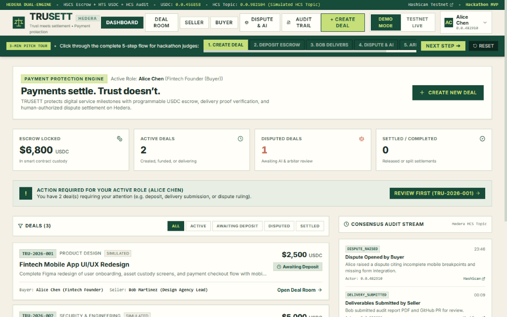
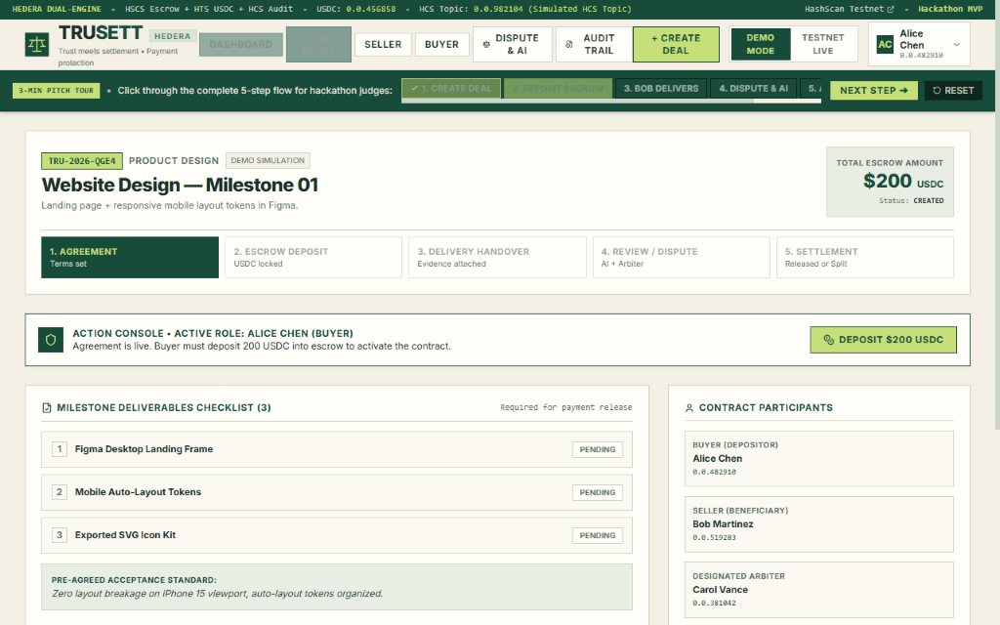
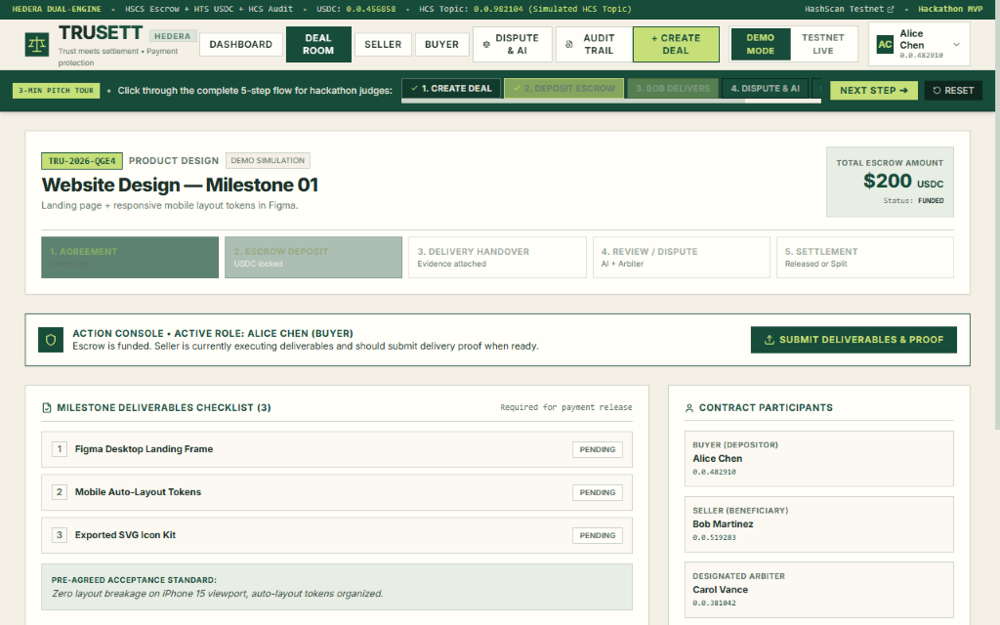
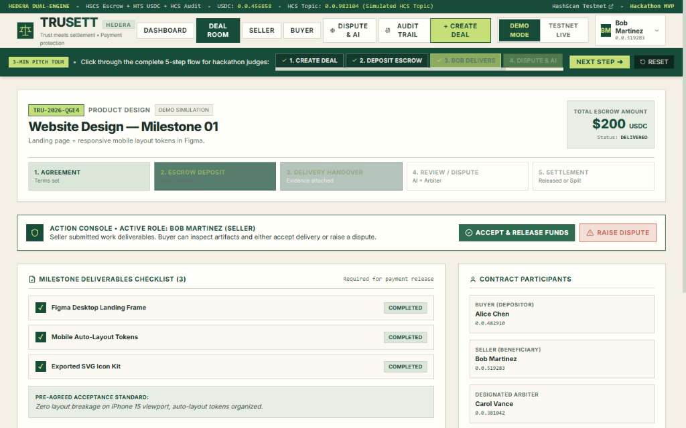
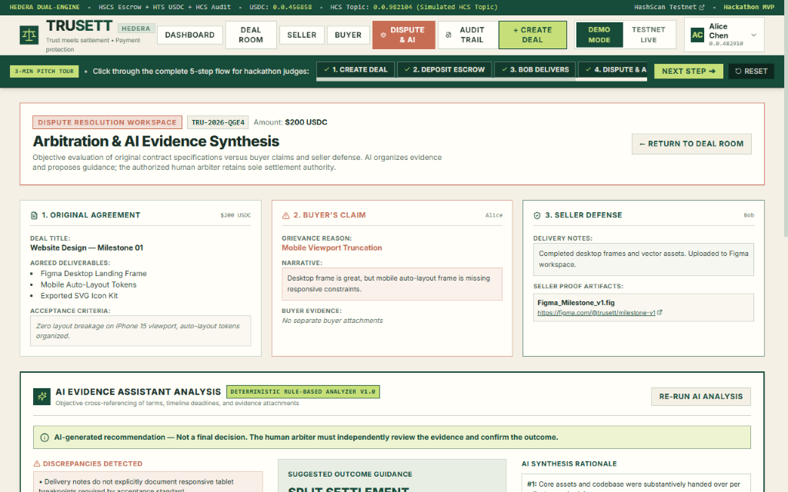
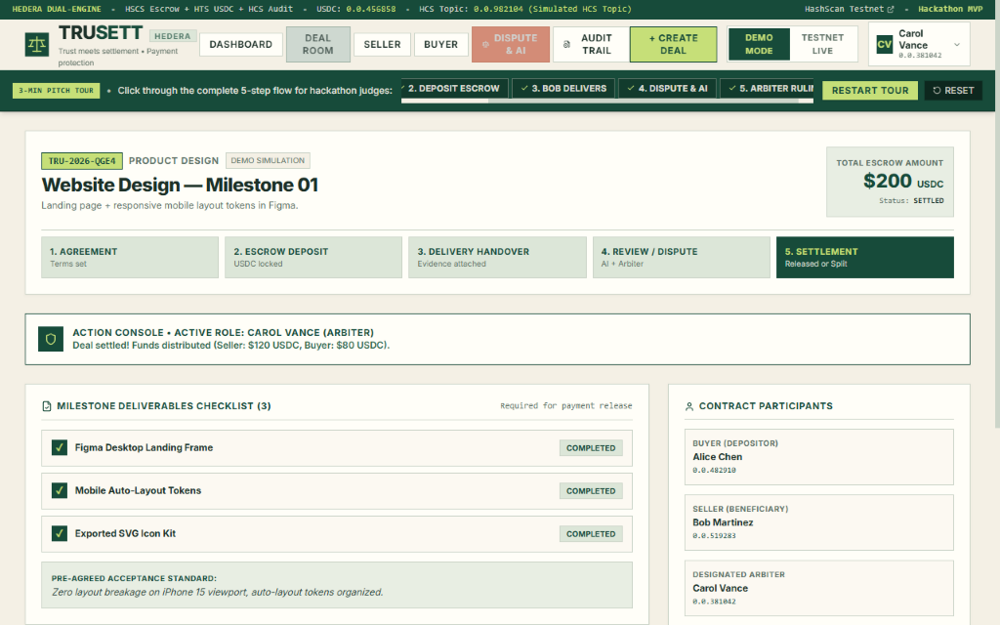
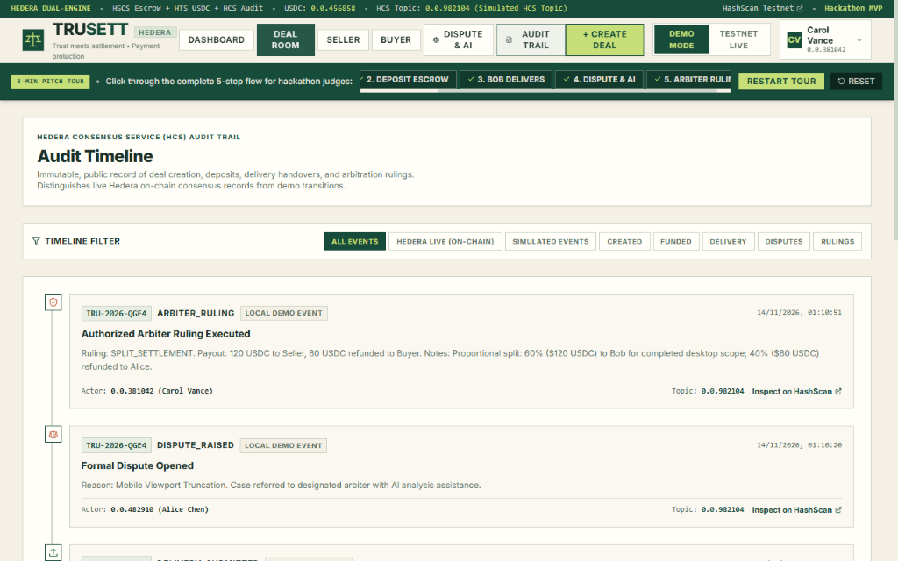

# TRUSETT — Trust Meets Settlement
### Hedera-Powered Payment Protection Protocol for Freelancers & Digital Agencies

[](https://hedera.com)
[](https://vitejs.dev)
[](https://fastapi.tiangolo.com)
[](https://soliditylang.org)
[](https://mariem-elbahat.github.io/panch/)

> **Live Interactive Demo:** [https://mariem-elbahat.github.io/panch/](https://mariem-elbahat.github.io/panch/)

TRUSETT intercepts irreversible stablecoin payments and wraps them in a verifiable milestone escrow, delivery evidence verification, and AI-assisted dispute resolution framework on the **Hedera Network**.

---

## 1. Product Architecture & Hedera Tri-Service Design

```
+---------------------------------------------------------------------------------------+
|                                    OFF-CHAIN LAYER                                    |
|   • React + TypeScript + Vite UI (Warm cream, forest green, modular square geometry)  |
|   • FastAPI Backend API + Local Persistent Database                                    |
|   • Sensitive documents, design files, & client code stay OFF-CHAIN for privacy       |
+-------------------------------------------+-------------------------------------------+
                                            |
                                            v
+---------------------------------------------------------------------------------------+
|                                HEDERA ON-CHAIN LAYER                                  |
|                                                                                       |
|   1. Hedera Smart Contract Service (HSCS)                                             |
|      • `contracts/TrusettEscrow.sol`                                                  |
|      • Manages non-custodial milestone funds custody, deal states, & settlement        |
|      • Validates deadlines, prevents reentrancy, and enforces authorized rulings      |
|                                                                                       |
|   2. Hedera Token Service (HTS)                                                       |
|      • Native USDC token movement (Hedera Testnet Token `0.0.456858`)                 |
|      • Contract automatically executes `associateToken` via precompile `0x167`        |
|                                                                                       |
|   3. Hedera Consensus Service (HCS)                                                   |
|      • Implemented with `hiero_sdk_python` (built upon `hello_panch.py`)              |
|      • Immutable public audit log of all deal milestones & arbitration outcomes       |
|      • Verified via HashScan Testnet Explorer: https://hashscan.io/testnet            |
+---------------------------------------------------------------------------------------+
```

---

## 2. Core Product Screens Built

1. **Dashboard (`/`)**:
   - Live metrics: Total Escrowed USDC, Active Deals, Disputed Deals, and Settled Deals.
   - Quick filter tabs (All, Active, Awaiting Deposit, Disputed, Settled).
   - Real-time consensus audit ticker with links to HashScan.
   - Header with active Role Switcher (Alice, Bob, Carol) and Demo/Testnet mode switcher.

2. **Create Deal Modal**:
   - Deal Title, Category, Scope description, Amount in USDC, and Milestone deadline.
   - Dynamic Deliverables checklist builder.
   - Objective Acceptance criteria definition.
   - Live **Payment Protection Pass** summary preview before confirmation.

3. **Deal Room (`deal-room`)**:
   - Unified transaction workspace with a 5-stage progress indicator:
     `1. Agreement` $\rightarrow$ `2. Escrow Deposit` $\rightarrow$ `3. Delivery` $\rightarrow$ `4. Dispute Review` $\rightarrow$ `5. Settlement`.
   - Role-specific contextual action banner indicating the current user's next step.
   - Deliverables completion checklist & evidence attachment vault.
   - Counterparty accounts and Hedera HCS topic audit link.

4. **Seller Workspace (`seller-workspace`)**:
   - Filtered view for Bob Martinez (Seller / Agency Lead).
   - Submit Delivery notes, attach GitHub PR / Figma links / IPFS hashes, and mark work delivered.

5. **Buyer Workspace (`buyer-workspace`)**:
   - Filtered view for Alice Chen (Buyer / Fintech Founder).
   - Single-click **Deposit USDC into Escrow** simulator / testnet executor.
   - Inspect submitted deliverables, **Accept Delivery & Release Funds**, or **Raise Dispute**.

6. **Dispute Resolution Workspace (`dispute-resolution`)**:
   - 3-column tripartite comparison: Original Agreement vs Buyer Claim vs Seller Defense.
   - **AI Evidence Assistant Panel**:
     - Extracts key claims and deliverables.
     - Detects inconsistencies (e.g. deadline overruns, missing responsive breakpoints).
     - Identifies missing proof elements.
     - Proposes recommended outcome with structured reasoning steps.
     - **Mandatory Guardrail:** Clearly labeled as an informational recommendation; AI never controls funds.
   - **Authorized Arbiter Console**:
     - 3 ruling outcomes: **Release to Seller (100%)**, **Refund to Buyer (100%)**, or **Split Settlement (% slider)**.
     - Mandatory confirmation modal before executing on Hedera.

7. **Audit Timeline (`audit-timeline`)**:
   - Chronological event stream with filters.
   - Clearly labels **Hedera Confirmed (On-Chain)** vs **Local Demo Event**.
   - Displays consensus timestamps, sequence numbers, and direct HashScan topic links.

---

## 3. Quick Start & Execution

### Prerequisites
- Node.js (v18+)
- Python (3.10+)

### Setup

1. **Install Backend Dependencies:**
   ```powershell
   python -m pip install -r requirements.txt
   ```

2. **Install Frontend Dependencies:**
   ```powershell
   cd frontend
   npm install
   cd ..
   ```

3. **Configure Environment Variables (Optional for Live Testnet):**
   Copy `.env.example` to `.env`:
   ```ini
   OPERATOR_ID=0.0.xxxxxxx
   OPERATOR_KEY=your_private_key_here
   HEDERA_NETWORK=testnet
   USDC_TOKEN_ID=0.0.456858
   DEMO_MODE=true
   ```
   *(By default, `DEMO_MODE=true` allows full end-to-end demonstrations without gas costs or testnet wallet dependencies).*

### Run Application

#### Option A: One-Click Launcher (PowerShell / Windows)
```powershell
.\run_app.ps1
```
Or double-click `run_app.bat`.

#### Option B: Manual Launch
In Terminal 1 (Backend):
```powershell
uvicorn backend.main:app --host 127.0.0.1 --port 8000 --reload
```

In Terminal 2 (Frontend):
```powershell
cd frontend
npm run dev
```

Open your browser at **http://localhost:5173**.

---

## 4. Visual Demo Tutorial & Workflow Screenshots

> [!TIP]
> **Try it live in your browser:** [https://mariem-elbahat.github.io/panch/](https://mariem-elbahat.github.io/panch/)  
> Use the **3-Min Pitch Tour Bar** at the top of the interface to click through each stage interactively during presentations.

### Step 1: Protocol Dashboard
The dashboard provides a real-time portfolio overview: total USDC held in contract custody, active deals, disputed cases, active role switching (Alice / Bob / Carol), and the live Hedera Consensus Service audit ticker.



---

### Step 2: Milestone Agreement Creation
The buyer and seller define deliverables, acceptance standards, and the USDC milestone budget. A unique deal ID is generated and an initial agreement event is broadcast to the HCS topic.



---

### Step 3: Non-Custodial USDC Escrow Deposit
The buyer deposits USDC into the Hedera smart contract. The contract automatically ensures HTS token association via system precompile `0x167` and transitions the state to **`FUNDED`**.



---

### Step 4: Seller Deliverables Handover
The seller completes milestone items (e.g. Figma auto-layout tokens, GitHub pull requests) and submits delivery notes with external proof links. All checklist items are marked complete and the deal transitions to **`DELIVERED`**.



---

### Step 5: Dispute Raised & AI Evidence Assistant Synthesis
If the deliverables fail acceptance standards (e.g. mobile viewport truncation), the buyer opens a dispute. The **AI Evidence Assistant** analyzes the contract, detects discrepancies, identifies missing documentation, and recommends a fair settlement (e.g. 60% seller / 40% buyer) with structured reasoning.  
*(AI recommendations are strictly informational; AI never independently controls funds).*



---

### Step 6: Authorized Arbiter Settlement Ruling
The designated human arbiter (Carol Vance) independently evaluates the evidence and confirms an authorized ruling (Release, Refund, or Split). The smart contract automatically distributes funds and updates status to **`SETTLED`**.



---

### Step 7: Immutable Hedera Consensus Service (HCS) Audit Trail
Every lifecycle state change (`DEAL_CREATED`, `ESCROW_FUNDED`, `DELIVERY_SUBMITTED`, `DISPUTE_RAISED`, `ARBITER_RULING`) is permanently recorded on Hedera Consensus Service with verifiable sequence numbers, timestamps, and direct HashScan links.



---

## 5. Security & Privacy Guardrails

- **Private Files Stay Off-Chain:** Sensitive client source code, design files, and communications remain off-chain; only cryptographic hashes and references are logged to Hedera.
- **Human Authority:** AI serves strictly as an analytical aid. Smart contracts allow only the designated arbiter address to resolve disputes.
- **Zero Key Leaks:** Private keys and personal access tokens are stored in `.env` (which is excluded via `.gitignore`) and are never exposed to the frontend.
- **Honest Mode Representation:** Simulated demo transactions are explicitly labeled as `SIMULATED` or `Local Demo Event`, while live Hedera transactions provide authentic transaction IDs and explorer links.
